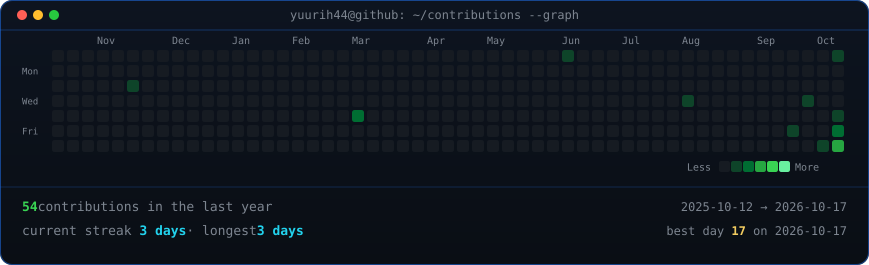

<h3><code>yuurih44@github ~ $ whoami</code></h3>

<h3><code>yuurih44@github ~ $ ./contributions.sh</code></h3>

## Projetos

- [auth-log-triage](https://github.com/Yuurih44/auth-log-triage) — triagem local de eventos de autenticação e geração de relatórios JSON.
- [http-header-review](https://github.com/Yuurih44/http-header-review) — análise de cabeçalhos HTTP de segurança.
- [task-api-sqlite](https://github.com/Yuurih44/task-api-sqlite) — API REST de tarefas com validação, paginação e SQLite.

## Contato

[LinkedIn](https://br.linkedin.com/in/yurisiqueiraalves) · [Instagram](https://www.instagram.com/_yyurialves/)

Cartão e calendário inspirados em <a href="https://github.com/valthvn/animated-terminal-profile">animated-terminal-profile</a>, sob licença MIT. O calendário é atualizado diariamente pelo GitHub Actions.
