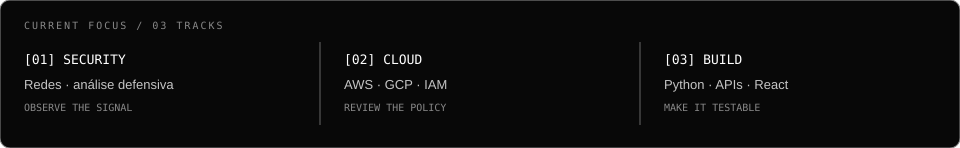

 

[LinkedIn](https://br.linkedin.com/in/yurisiqueiraalves) &nbsp;·&nbsp; [GitHub](https://github.com/Yuurih44?tab=repositories)

 

 

Estudando Cibersegurança e Desenvolvimento de Sistemas · São Paulo, Brasil

