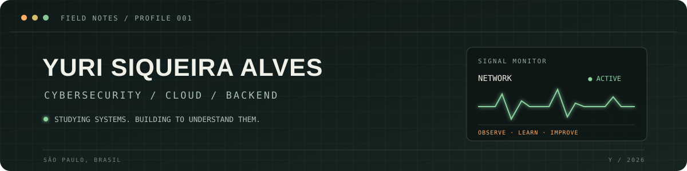

<div align="center">



<br />

**Estudante de Cibersegurança e Desenvolvimento de Sistemas · São Paulo, Brasil**

[LinkedIn](https://br.linkedin.com/in/yurisiqueiraalves) · [Projetos](https://github.com/Yuurih44?tab=repositories)

</div>

<br />

```text
┌─ DIREÇÃO ──────────────────────────────────────────────────────────┐
│ Segurança em nuvem · Fundamentos de redes · APIs e backend seguro │
└───────────────────────────────────────────────────────────────────┘
```

Estudo como sistemas funcionam para aprender a protegê-los. Tenho explorado segurança em nuvem, análise de eventos e desenvolvimento de aplicações, transformando esses estudos em projetos pequenos, documentados e testáveis.

## Em campo

| Projeto | O que faz |
| --- | --- |
| [IAM Policy Auditor](https://github.com/Yuurih44/iam-policy-auditor) | Analisa arquivos de políticas AWS IAM localmente e sinaliza permissões amplas. |
| [Auth Log Triage](https://github.com/Yuurih44/auth-log-triage) | Organiza eventos de autenticação para facilitar uma triagem inicial. |
| [HTTP Header Review](https://github.com/Yuurih44/http-header-review) | Verifica a presença de cabeçalhos HTTP de segurança em entradas JSON. |
| [Task API SQLite](https://github.com/Yuurih44/task-api-sqlite) | API REST em Python com persistência SQLite, validação e paginação. |
| [Teste Front-End](https://github.com/Yuurih44/teste-front-end) | Catálogo responsivo desenvolvido em React e TypeScript a partir de um desafio técnico. |

## Caixa de ferramentas

```yaml
estudando:
  seguranca: [cibersegurança, fundamentos de redes, análise de eventos]
  cloud: [AWS, Google Cloud]
  desenvolvimento: [Python, Flask, APIs REST, SQL]
  dados: [MySQL, SQL Server, SQLite]
  interfaces: [React, TypeScript, HTML, CSS, Sass]
```

## No meu radar

- Aprofundar fundamentos de IAM e configuração segura em nuvem.
- Criar ferramentas locais que expliquem seus resultados e possam ser verificadas por testes.
- Melhorar a documentação e a qualidade dos projetos a cada iteração.

## Conecte-se

[](https://br.linkedin.com/in/yurisiqueiraalves)
[](https://github.com/Yuurih44?tab=repositories)

<div align="center">

<sub>Aprender, testar, documentar, repetir.</sub>

</div>
