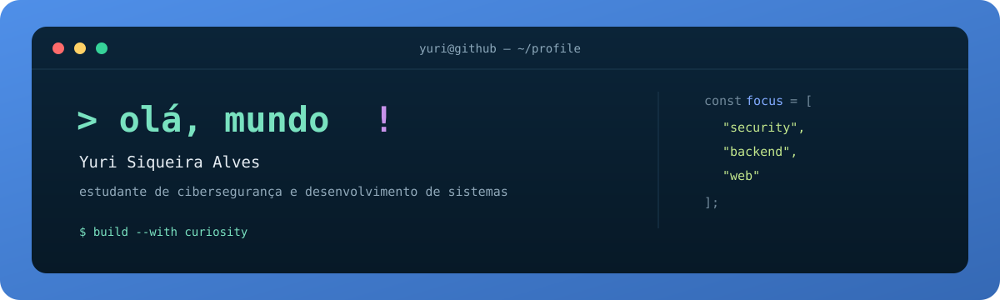

  

## Sobre mim

Sou estudante de Cibersegurança e Desenvolvimento de Sistemas no SENAI, em São Paulo. Tenho interesse em segurança em nuvem, backend e desenvolvimento web. Uso projetos pessoais para praticar, testar ideias e documentar o que aprendo.

- **Cibersegurança** — SENAI São Caetano
- **Desenvolvimento de Sistemas** — SENAI Mooca
- **Estudando:** AWS, Google Cloud, Python e TypeScript

## Projetos

- **[Econverse — Teste Front-End](https://github.com/Yuurih44/teste-front-end)** — catálogo responsivo feito com React, TypeScript e Sass, com uma versão fiel ao teste e outra com funcionalidades extras.
- **[IAM Policy Auditor](https://github.com/Yuurih44/iam-policy-auditor)** — CLI educativa que analisa políticas AWS IAM em JSON e aponta padrões comuns de permissões arriscadas.
- **[Task API SQLite](https://github.com/Yuurih44/task-api-sqlite)** — API REST para tarefas com validação, paginação, persistência local e testes HTTP.
- **[Auth Log Triage](https://github.com/Yuurih44/auth-log-triage)** — ferramenta local que resume eventos de autenticação e sinaliza falhas repetidas por IP.

## Tecnologias

  

`Python` · `TypeScript` · `JavaScript` · `React` · `Flask` · `SQL` · `SQLite` · `AWS` · `Google Cloud` · `Linux` · `Git`

## Contato

[LinkedIn](https://br.linkedin.com/in/yurisiqueiraalves) · [GitHub](https://github.com/Yuurih44)
