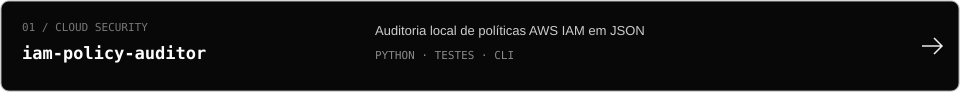
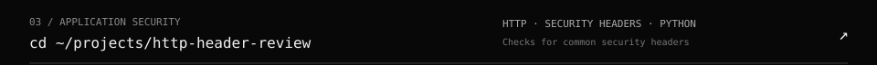
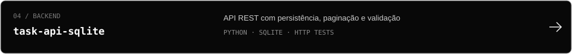
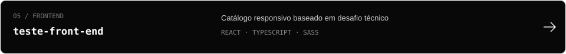

 

[LinkedIn](https://br.linkedin.com/in/yurisiqueiraalves) &nbsp;·&nbsp; [GitHub](https://github.com/Yuurih44?tab=repositories)

 

 

### PROJETOS EM DESTAQUE

 
 
 
 

 

Estudando Cibersegurança e Desenvolvimento de Sistemas · São Paulo, Brasil

