<p align="center">
  
</p>

<p align="center">
  <a href="https://br.linkedin.com/in/yurisiqueiraalves">LinkedIn</a> &nbsp;·&nbsp;
  <a href="https://www.instagram.com/_yyurialves/">Instagram</a> &nbsp;·&nbsp;
  <a href="https://github.com/Yuurih44?tab=repositories">Repositórios</a>
</p>

### `~ $ whoami`

Sou **Yuri Siqueira Alves**, estudante de cibersegurança no **SENAI São Caetano**, com estudos em desenvolvimento de sistemas no **SENAI Mooca**.

Meu foco está em **segurança em nuvem, backend e infraestrutura**. Aqui compartilho projetos e estudos que conectam desenvolvimento de APIs, análise de eventos e revisão de configurações de segurança.

### `~ $ ls projects/`

| Projeto | O que você encontra | Tecnologias |
| :--- | :--- | :--- |
| [auth-log-triage](https://github.com/Yuurih44/auth-log-triage) | Triagem offline de eventos de autenticação, correlação por IP e relatórios JSON. | Python |
| [http-header-review](https://github.com/Yuurih44/http-header-review) | Revisão offline de cabeçalhos HTTP: HSTS, nosniff e presença de CSP. | Python · JSON |
| [task-api-sqlite](https://github.com/Yuurih44/task-api-sqlite) | API REST de tarefas com CRUD, validação, paginação e persistência. | Python · SQLite |

<details>
<summary><code>~ $ cat stack.json</code> — tecnologias e estudos</summary>

```json
{
  "focus": ["Cloud Security", "Backend", "Infrastructure"],
  "security": ["Network Security"],
  "cloud": ["AWS", "Google Cloud Platform"],
  "backend": ["Python", "Flask", "REST APIs", "SQL"],
  "databases": ["MySQL", "SQL Server", "SQLite"],
  "tools": ["Linux", "Git", "GitHub", "VS Code"]
}
```

</details>

---

<p align="center">
  <sub>“Security isn't a feature — it's a foundation.”</sub>
</p>
