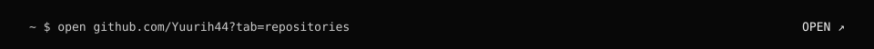
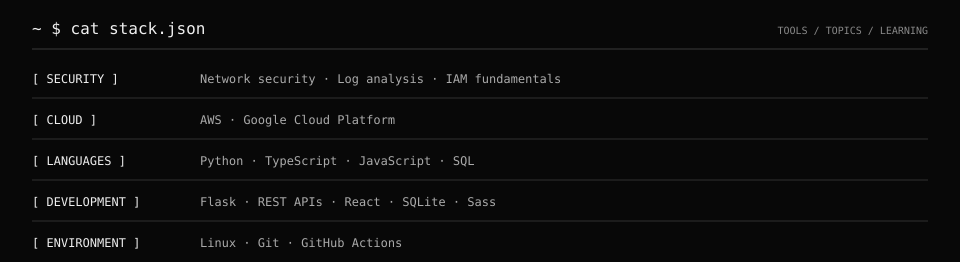
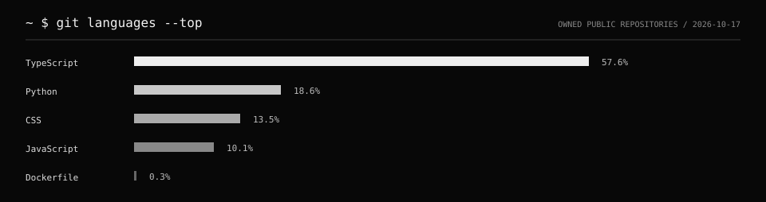

<!-- YURIH44 / SESSION 001 -->

 
 
 

<code>~ $ help</code>

`projects/` — browse the repositories above.

`stack` — tools and areas I am learning.

`languages` — language bytes across my own repositories.

`activity.log` — public contribution activity.

[LinkedIn](https://br.linkedin.com/in/yurisiqueiraalves) · [Instagram](https://www.instagram.com/_yyurialves/)

